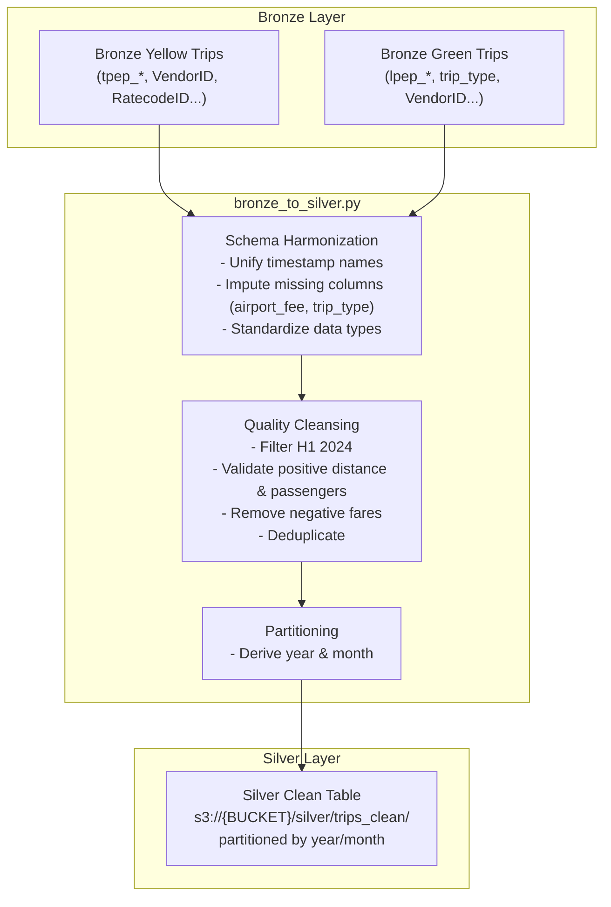

# NYC Taxi Data Lakehouse - Silver Layer Data Dictionary

## 1. Overview & Dataset Description

The **Silver Layer (`trips_clean`)** represents the cleansed, harmonized, and standardized data model for New York City Taxi trip records (combining both **Yellow Medallion Taxis** and **Green Street-Hail Livery Taxis**). 

The raw data ingested into the Bronze layer contains discrepancies in column naming conventions (e.g., `tpep_pickup_datetime` vs. `lpep_pickup_datetime`), differing metadata attributes (e.g., `airport_fee`, `trip_type`), and data quality anomalies (negative fares, zero distances, dates outside the target range). The Silver layer unifies these datasets into a single, high-integrity schema optimized for analytical querying, metric aggregation, and Gold-layer data marts.

- **Storage Format**: Apache Parquet (Snappy compressed)
- **Target Table / Path**: `s3://{S3_BUCKET_NAME}/silver/trips_clean/`
- **Partitioning Strategy**: `year` (YYYY), `month` (MM) — derived from `pickup_datetime`
- **ETL Transformation Script**: [`src/transform/bronze_to_silver.py`](file:///c:/Users/Windows%2010/Desktop/de_project_taxi/src/transform/bronze_to_silver.py)

---

## 2. Table Schema & Column Definitions

| # | Column Name | Data Type | Nullable | Source Field (Yellow) | Source Field (Green) | Description |
|---|---|---|---|---|---|---|
| 1 | `taxi_type` | `STRING` | No | Constant (`'yellow'`) | Constant (`'green'`) | Identifier for the taxi service type (`yellow` = Medallion Taxi, `green` = Street Hail Livery / Boro Taxi). |
| 2 | `vendor_id` | `INTEGER` | Yes | `VendorID` | `VendorID` | A code indicating the TPEP/LPEP provider that provided the record (see [Vendor Lookup](#31-vendor-id-vendor_id)). |
| 3 | `pickup_datetime` | `TIMESTAMP` | No | `tpep_pickup_datetime` | `lpep_pickup_datetime` | The date and time when the meter was engaged. |
| 4 | `dropoff_datetime` | `TIMESTAMP` | No | `tpep_dropoff_datetime` | `lpep_dropoff_datetime` | The date and time when the meter was disengaged. |
| 5 | `passenger_count` | `INTEGER` | No | `passenger_count` | `passenger_count` | The number of passengers in the vehicle (driver-entered value; validated > 0). |
| 6 | `trip_distance` | `DOUBLE` | No | `trip_distance` | `trip_distance` | The elapsed trip distance in miles reported by the taximeter (validated > 0.0). |
| 7 | `rate_code_id` | `INTEGER` | Yes | `RatecodeID` | `RatecodeID` | The final rate code in effect at the end of the trip (see [Rate Code Lookup](#32-rate-code-rate_code_id)). |
| 8 | `store_and_fwd_flag` | `STRING` | Yes | `store_and_fwd_flag` | `store_and_fwd_flag` | Flag indicating whether the trip record was held in vehicle memory before sending: `Y` (store and forward), `N` (not a store and forward trip). |
| 9 | `pickup_location_id` | `INTEGER` | Yes | `PULocationID` | `PULocationID` | TLC Taxi Zone ID in which the taximeter was engaged (corresponds to NYC TLC Taxi Zone map). |
| 10 | `dropoff_location_id` | `INTEGER` | Yes | `DOLocationID` | `DOLocationID` | TLC Taxi Zone ID in which the taximeter was disengaged (corresponds to NYC TLC Taxi Zone map). |
| 11 | `payment_type` | `INTEGER` | Yes | `payment_type` | `payment_type` | Numeric code signifying how the passenger paid for the trip (see [Payment Type Lookup](#33-payment-type-payment_type)). |
| 12 | `fare_amount` | `DOUBLE` | No | `fare_amount` | `fare_amount` | The time-and-distance fare calculated by the meter (validated >= 0.0). |
| 13 | `extra` | `DOUBLE` | Yes | `extra` | `extra` | Miscellaneous extras and surcharges (e.g., $0.50 and $1.00 rush hour and overnight charges). |
| 14 | `mta_tax` | `DOUBLE` | Yes | `mta_tax` | `mta_tax` | $0.50 MTA tax that is automatically triggered based on the metered rate in use. |
| 15 | `tip_amount` | `DOUBLE` | Yes | `tip_amount` | `tip_amount` | Tip amount. Automatically populated for credit card tips; cash tips are not included. |
| 16 | `tolls_amount` | `DOUBLE` | Yes | `tolls_amount` | `tolls_amount` | Total amount of all tolls paid in trip. |
| 17 | `improvement_surcharge` | `DOUBLE` | Yes | `improvement_surcharge` | `improvement_surcharge` | Improvement surcharge assessed on hailed trips at the flag drop. |
| 18 | `congestion_surcharge` | `DOUBLE` | Yes | `congestion_surcharge` | `congestion_surcharge` | Congestion surcharge for trips passing through the Manhattan congestion zone. |
| 19 | `airport_fee` | `DOUBLE` | No | `airport_fee` | *Defaulted (`0.0`)* | Airport pickup / dropoff surcharge (applied to Yellow taxis; defaulted to `0.0` for Green if absent). |
| 20 | `cbd_congestion_fee` | `DOUBLE` | No | `cbd_congestion_fee` | *Defaulted (`0.0`)* | Congestion Relief Zone / CBD fee (defaulted to `0.0` if absent in source). |
| 21 | `total_amount` | `DOUBLE` | No | `total_amount` | `total_amount` | The total amount charged to passengers. Does not include cash tips (validated >= 0.0). |
| 22 | `trip_type` | `INTEGER` | No | *Defaulted (`1`)* | `trip_type` | Code indicating whether trip was street-hail or dispatch (see [Trip Type Lookup](#34-trip-type-trip_type); Yellow defaulted to `1`). |
| 23 | `year` *(Partition Key)* | `INTEGER` | No | Derived | Derived | 4-digit year extracted from `pickup_datetime` (e.g., `2024`). Used for physical partitioning. |
| 24 | `month` *(Partition Key)* | `STRING` | No | Derived | Derived | 2-digit zero-padded month extracted from `pickup_datetime` (e.g., `'01'`, `'06'`). Used for physical partitioning. |

---

## 3. Reference & Code Lookups

### 3.1. Vendor ID (`vendor_id`)
| Code | Vendor / Provider Name |
|---|---|
| `1` | Creative Mobile Technologies, LLC (CMT) |
| `2` | VeriFone Inc. (VTS) |

### 3.2. Rate Code (`rate_code_id`)
| Code | Rate Type | Description |
|---|---|---|
| `1` | Standard rate | Standard metered city rate |
| `2` | JFK | Flat rate to/from JFK Airport and Manhattan |
| `3` | Newark | Negotiated/special rate to/from Newark Airport |
| `4` | Nassau or Westchester | Standard metered rate with Nassau/Westchester surcharge |
| `5` | Negotiated fare | Agreed-upon flat fare |
| `6` | Group ride | Group ride tariff |
| `99` | Other | Special or unrecognized rate code |

### 3.3. Payment Type (`payment_type`)
| Code | Description | Notes |
|---|---|---|
| `1` | Credit card | Tips are electronically captured in `tip_amount` |
| `2` | Cash | Tips are not recorded (`tip_amount` = 0) |
| `3` | No charge | Free / promotional ride |
| `4` | Dispute | Customer contested charges |
| `5` | Unknown | Payment method unrecorded |
| `6` | Voided trip | Trip cancelled / voided |

### 3.4. Trip Type (`trip_type`)
| Code | Description | Notes |
|---|---|---|
| `1` | Street-hail | Flagged down directly on the street (Default for all Yellow taxi trips) |
| `2` | Dispatch | Pre-arranged trip via livery base / dispatch service |

---

## 4. Data Quality & Cleansing Rules (Silver Transformations)

The Silver pipeline enforces strict business validation and filtering rules implemented in [`src/transform/bronze_to_silver.py`](file:///c:/Users/Windows%2010/Desktop/de_project_taxi/src/transform/bronze_to_silver.py):

| Rule Category | Validation / Filter Logic | Rationale |
|---|---|---|
| **Temporal Range** | `pickup_datetime >= '2024-01-01 00:00:00' AND pickup_datetime < '2024-07-01 00:00:00'` | Restricts records strictly to H1 2024, eliminating erroneous future or past timestamp anomalies generated by hardware clocks. |
| **Chronological Order** | `dropoff_datetime > pickup_datetime` | Eliminates invalid trips where dropoff time precedes or equals pickup time. |
| **Passenger Count** | `passenger_count > 0` | Eliminates ghost rides and unmetered test records where passenger count is 0 or negative. |
| **Trip Distance** | `trip_distance > 0.0` | Filters out non-movement entries, meter resets, and erroneous stationary records. |
| **Financial Integrity** | `fare_amount >= 0.0 AND total_amount >= 0.0` | Removes chargebacks, negative test transactions, and erroneous dispute entries from standard operational metrics. |
| **Deduplication** | `.dropDuplicates()` | Removes duplicate rows resulting from upstream re-ingestions or overlapping batch exports. |

---

## 5. Source-to-Target Lineage Matrix

