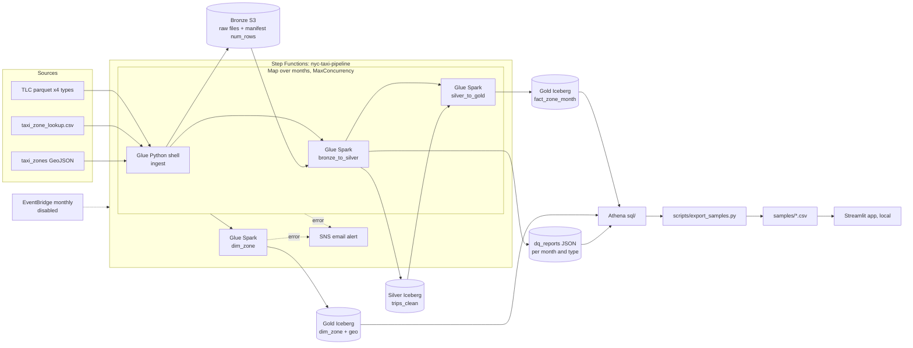

# NYC TLC Trip-Type Lakehouse — Submission 2 (Reproducible Pipeline)

## 1. Problem, objective, hypotheses

**Main question:** which **TLC trip record type** was used most from **Feb 2019 to the latest available month**?
Types: `yellow`, `green`, `fhv`, `hvfhv`.

- **"Type"** = TLC trip record type. FHV/HVFHV are not legally taxis, so every result is shown both **taxi-only (yellow + green)** and **all types**.
- **"Most used"** = trip count (rows in the trip records after DQ).
- **Why Feb 2019:** the HVFHS licence category took effect 1 Feb 2019 (HVFHS dictionary). From 2019 high-volume companies are split out of FHV (FHV dictionary). Before that, Uber/Lyft sit inside FHV, so the types can't be compared.
- **Original S1 question (still answered):** most used type in **H1 2024**, as yellow vs green and as all 4 types.

| # | Hypothesis | Answered by |
|---|---|---|
| H1 | One type has the most total trips over the whole period | `sql/q_h1.sql` |
| H2 | The leading type changes over time (and when) | `sql/q_h2.sql` |
| H3 | The answer holds for taxi-only vs all types, and with shared/pooled trips excluded | `sql/q_h3.sql` |
| H4 | DQ rules don't distort the answer (raw footer rows vs clean rows per month and type) | `sql/q_h4.sql` |
| H5 | The leading type differs by area | `sql/q_h5.sql`, Streamlit map |

## 2. Data sources

| Source | Format | URL |
|---|---|---|
| Yellow / Green / FHV / HVFHV trip records | Parquet, one file per type and month | `https://d37ci6vzurychx.cloudfront.net/trip-data/{yellow,green,fhv,fhvhv}_tripdata_YYYY-MM.parquet` |
| Data dictionaries | PDF | `data_dictionary_trip_records_{yellow,green,fhv,hvfhs}.pdf` (in repo) |
| Taxi zone lookup | CSV | `https://d37ci6vzurychx.cloudfront.net/misc/taxi_zone_lookup.csv` |
| Taxi zone polygons | GeoJSON | `https://data.cityofnewyork.us/api/geospatial/8meu-9t5y?method=export&format=GeoJSON` (NYC Open Data "NYC Taxi Zones", WGS84, zone id in property `locationid`; `ZonesGeoJsonUrl` stack parameter). TLC's `taxi_zones.zip` is the same zones as a Shapefile in EPSG:2263, so it would need reprojecting. |

How the source schemas differ (mapping lives in [`src/lib/taxi_types.py`](src/lib/taxi_types.py), matched case-insensitively):

| Canonical | yellow | green | fhv | hvfhv |
|---|---|---|---|---|
| `operator` | `VendorID` | `VendorID` | `dispatching_base_num` | `hvfhs_license_num` |
| `pickup_datetime` | `tpep_pickup_datetime` | `lpep_pickup_datetime` | `pickup_datetime` | `pickup_datetime` |
| `dropoff_datetime` | `tpep_dropoff_datetime` | `lpep_dropoff_datetime` | `dropOff_datetime` | `dropoff_datetime` |
| `pickup_location_id` | `PULocationID` | `PULocationID` | `PUlocationID` | `PULocationID` |
| `is_shared` | false | false | `SR_Flag = 1` | `shared_match_flag = 'Y'` |
| `passenger_count` | ✓ | ✓ | – | – |
| `trip_distance` | `trip_distance` | `trip_distance` | – | `trip_miles` |
| fares (raw, not compared) | `fare_amount, tip_amount, total_amount, airport_fee (Airport_fee), congestion_surcharge, cbd_congestion_fee` | same, no airport fee | – | `base_passenger_fare, tolls, bcf, sales_tax, congestion_surcharge, airport_fee, tips, cbd_congestion_fee` |

## 3. Architecture



- **Bronze** `s3://<bucket>/bronze/taxi_type=<t>/year=<y>/month=<mm>/<file>.parquet`: raw, untouched. `manifest/year_month=<m>/manifest.json` has the footer `num_rows` per file.
- **Silver** `glue.nyc_taxi.trips_clean`: canonical schema, partitioned `months(pickup_datetime), taxi_type`.
- **Gold** `glue.nyc_taxi.fact_zone_month(year_month, taxi_type, pickup_location_id, trips, shared_trips)` and `glue.nyc_taxi.dim_zone(location_id, borough, zone, service_zone)`.
- **Incremental per month:** every job takes `--YEAR_MONTH` and replaces only that month's partitions (`overwritePartitions`), so re-runs are idempotent. The state machine input `"latest"` makes ingest find the newest published month.
- **Month filter:** TLC files contain pickups from other months. Silver keeps only pickups inside `--YEAR_MONTH`, and the rest count as the `out_of_month` reject. Without this, a Feb run would overwrite part of Jan.
- **Fallback:** `TableFormat=parquet` writes the same layout as Hive-style parquet (`s3://<bucket>/parquet/<table>/year_month=…/taxi_type=…`) if Iceberg is blocked.

## 4. Repo structure

```
infra/            template.yaml (CloudFormation), deploy.sh, teardown.sh
orchestration/    state_machine.json (Step Functions, CFN DefinitionSubstitutions)
src/lib/          taxi_types.py (per-type mappings + DQ rules as data), job_utils.py (args, S3 JSON), lake.py (Spark/Iceberg)
src/ingestion/    ingest.py
src/transform/    bronze_to_silver.py, silver_to_gold.py, dim_zone.py
sql/              ddl.sql, q_original_h1_2024.sql, q_h1..q_h5.sql, q_dq_summary.sql, q_iceberg_snapshots.sql, q_silver_sample.sql
scripts/          export_samples.py (Athena -> samples/)
samples/          exported CSVs + taxi_zones.geojson (committed)
app/              streamlit_app.py (local, no AWS)
docs/evidence/    screenshots / exports of runs
tests/            test_mapping.py
```

## 5. Setup and run

> **Every command below is bash.** On Windows run them in **Git Bash** (comes with Git for Windows), not PowerShell or cmd: `infra/*.sh` are bash scripts and the `export`/`$VAR` syntax is bash.

### 5.0 One-time setup (local machine)

Prerequisites: AWS Academy Learner Lab (`us-east-1`), AWS CLI v2, Git Bash (Windows) or any bash, Python 3.10+.

```bash
python -m venv .venv
```

```bash
source .venv/Scripts/activate   # Windows Git Bash; on macOS/Linux: source .venv/bin/activate
```

```bash
pip install -r requirements.txt
```

### 5.1 Every Learner Lab session: credentials + variables

**Credentials (only one place: `~/.aws/credentials`).** Learner Lab tokens expire after about 4 hours. When that happens, every AWS call fails with `ExpiredTokenException`:

1. Learner Lab → **Start Lab** (wait for the green dot) → **AWS Details** → **AWS CLI: Show**.
2. Paste the 3 lines under `[default]` in `~/.aws/credentials` (overwrite the old ones).
3. Check:

```bash
aws sts get-caller-identity
```

The AWS CLI, `infra/*.sh` and `scripts/export_samples.py` all read this same file. Don't put keys in a `.env` file or in `export AWS_...` variables: environment variables override the file, so an old token there keeps failing after you refresh. If you did set them, clear them:

```bash
unset AWS_ACCESS_KEY_ID AWS_SECRET_ACCESS_KEY AWS_SESSION_TOKEN
```

**Variables (set again in every new Git Bash window).** Bucket names must be globally unique, so add a suffix:

```bash
export BUCKET=nyc-taxi-lake-<suffix> ATHENA_BUCKET=nyc-taxi-athena-<suffix> ALERT_EMAIL=<you@example.com>
```

```bash
export LAB_ROLE_ARN=arn:aws:iam::$(aws sts get-caller-identity --query Account --output text):role/LabRole
```

### 5.2 Deploy 

```bash
aws cloudformation validate-template --template-body file://infra/template.yaml
```

```bash
infra/deploy.sh
```

 deploys the stack, and syncs `src/` to `s3://$BUCKET/scripts/`. Confirm the SNS subscription email. Then save the state machine ARN:

```bash
export SFN_ARN=$(aws cloudformation describe-stacks --stack-name nyc-taxi-pipeline --query "Stacks[0].Outputs[?OutputKey=='StateMachineArn'].OutputValue" --output text)
```

### 5.3 Run the pipeline

1. **Smoke test** (green, one month). Watch it in the Step Functions console. If it fails on Iceberg, redeploy with `TABLE_FORMAT=parquet infra/deploy.sh`.

```bash
aws stepfunctions start-execution --state-machine-arn "$SFN_ARN" --input '{"months":["2024-01"],"taxi_types":["green"]}'
```

2. **Backfill one year per execution** . Use `"latest"` for the newest month. Save evidence into `docs/evidence/` right after each run.

```bash
aws stepfunctions start-execution --state-machine-arn "$SFN_ARN" --input '{"months":["2019-02","2019-03","2019-04","2019-05","2019-06","2019-07","2019-08","2019-09","2019-10","2019-11","2019-12"],"taxi_types":["yellow","green","fhv","hvfhv"]}'
```

### 5.4 Export results → `samples/`

Needs valid credentials (5.1). Runs the `sql/` queries on Athena and writes `samples/*.csv` and `samples/taxi_zones.geojson`. Commit `samples/` afterwards.

```bash
python scripts/export_samples.py --bucket "$BUCKET" --athena-results-bucket "$ATHENA_BUCKET"
```

### 5.5 Dashboard and tests (local, no AWS)

The dashboard needs `samples/` from 5.4.

```bash
streamlit run app/streamlit_app.py
```

```bash
python -m pytest tests
```

### 5.6 Teardown 

```bash
infra/teardown.sh
```

## 6. Data quality

Rules are data in [`src/lib/taxi_types.py`](src/lib/taxi_types.py) and are applied in `bronze_to_silver.py`. A rule that doesn't apply to a type is reported as `null`, not `0`.

| Rule | Kind | yellow | green | fhv | hvfhv |
|---|---|---|---|---|---|
| `out_of_month` (pickup outside `--YEAR_MONTH`, or null) | reject | ✓ | ✓ | ✓ | ✓ |
| `dropoff_before_pickup` (`dropoff <= pickup`) | reject | ✓ | ✓ | ✓ | ✓ |
| `negative_amount` (`fare_amount`/`total_amount` < 0; hvfhv `base_passenger_fare` < 0) | reject | ✓ | ✓ | null | ✓ |
| `negative_distance` | reject | ✓ | ✓ | null | ✓ |
| `passenger_count_invalid` (null or ≤ 0) | flag | ✓ | ✓ | null | null |
| `pickup_location_null` | flag | ✓ | ✓ | ✓ | ✓ |
| `shared` | flag | ✓ (always 0) | ✓ (always 0) | ✓ | ✓ |

- **Report** per month and type: `s3://<bucket>/dq_reports/year_month=<m>/taxi_type=<t>/report.json`. It is also printed as a `[DQ]` line in CloudWatch and queryable as `nyc_taxi.dq_reports` (`sql/ddl.sql`).
- **Threshold:** the job fails if `written_rows == 0` or `reject_rate > MAX_REJECT_RATE` (default 0.10). Reports are written first, and nothing is written to Silver for that month.
- **Summary:** `samples/dq_summary.csv` (`sql/q_dq_summary.sql`).
- **H4 reconciliation:** `samples/answer_h4.csv` compares footer rows, Silver written rows and Gold trips per month and type.

## 7. Results

> Filled in after the backfill from `samples/` (exported by `scripts/export_samples.py`).

### Original question — H1 2024
- Taxi only (yellow vs green, compare with S1): _table from `samples/answer_original_h1_2024.csv`, view `taxi_only`_
- All 4 types: _same file, view `all_types`_

### H1–H5
- **H1** total trips by type: `samples/answer_h1.csv`
- **H2** leader per month: `samples/answer_h2.csv` + trend chart in the app
- **H3** definition robustness: `samples/answer_h3.csv`
- **H4** DQ reconciliation: `samples/answer_h4.csv`
- **H5** leading type per zone: `samples/answer_h5.csv` + dominant-type map in the app

## 8. Evidence (`docs/evidence/`)

| Evidence | File |
|---|---|
| Step Functions graph and a successful Map run | _todo_ |
| Glue job run history (4 jobs) | _todo_ |
| CloudWatch `[DQ]` log line | _todo_ |
| A DQ report JSON | _todo_ |
| Iceberg snapshots / history (`sql/q_iceberg_snapshots.sql`) | _todo_ |
| SNS failure alert (optional) | _todo_ |

## 9. Design decisions

> _Placeholder: write these in your own words._

- **"Most used" = trip count, Feb 2019 start:** _hints: HVFHS licence effective 1 Feb 2019; FHV split from 2019; fares not comparable across types._
- **Incremental per month + month filter:** _hints: idempotent `overwritePartitions`; Learner Lab 4h sessions → resumable chunks; cross-month records would overwrite neighbours._
- **Iceberg vs Hive parquet:** _hints: atomic commits, no MSCK REPAIR, snapshots as run evidence; parquet fallback switch._
- **DQ flag/report vs silent drop:** _hints: S1 `passenger_count > 0` undercounted trips; per-type applicability; fail threshold._
- **Gold limited to question-serving metrics:** _hints: why revenue/tip/distance KPIs were cut._
- **CloudFormation:** _hints: CDK bootstrap needs IAM role creation, blocked in Learner Lab._
- **Local Streamlit:** _hints: no hosting cost/credentials; reads committed samples._

## 10. Submission 1 → Submission 2

| Aspect | S1 (notebook + baseline code) | S2 |
|---|---|---|
| Scope | yellow + green, H1 2024 | 4 types, Feb 2019 → latest; H1 2024 still answered |
| Ingest | hardcoded bucket/months; HTTP failures exit 0; existence-only skip | args only; non-zero exit; size-checked skip; footer row counts in manifest |
| Schema | glob read across months; case-sensitive `airport_fee` bug | per-type mapping as data, case-insensitive, per-file cast |
| DQ | silent filter (incl. `passenger_count > 0`) | type-aware rejects + flags, JSON report, fail threshold |
| Storage | parquet, static overwrite of whole table | Iceberg, per-month `overwritePartitions` |
| Gold | revenue/tip/distance KPIs | `trips`, `shared_trips` only |
| Orchestration | 2 sequential jobs + MSCK REPAIR | Map over months, retries/timeouts, SNS alert, schedule |
| Infra | console, by hand | CloudFormation |
| Presentation | notebook charts | SQL per hypothesis, exported samples, Streamlit map |

## 11. Limitations

- Pre-2019 out of scope: HVFHV did not exist and pre-2017 records use lat/lon.
- Late records that arrive in another month's file are dropped (`out_of_month`).
- Row meaning differs: a taxi row is one metered trip, while an FHV/HVFHV row is one booking. Pooled rides are counted per passenger booking.
- Lyft (bases B02510, B02844) over-flags `SR_Flag` (also unmatched shared requests), so FHV `shared_trips` is an upper bound.
- FHV has a high share of null `PUlocationID`; those trips are counted but not mapped (H5).
- Revenue is not compared because fare definitions differ by type.
- No Iceberg maintenance (compaction, snapshot expiry).
- Learner Lab: LabRole only, 4h sessions, budget cap; the schedule depends on LabRole trusting EventBridge.

## 12. Future work

- Revenue comparison with a harmonised fare definition.
- Per-company HVFHV split (`hvfhs_license_num` is already in Silver as `operator`).
- Pre-2019 coverage using a spatial join on lat/lon.
- Wait-time metrics (`request_datetime`, `on_scene_datetime`).

## 13. Learning reflection

> _Placeholder: 3–5 sentences in your own words._
