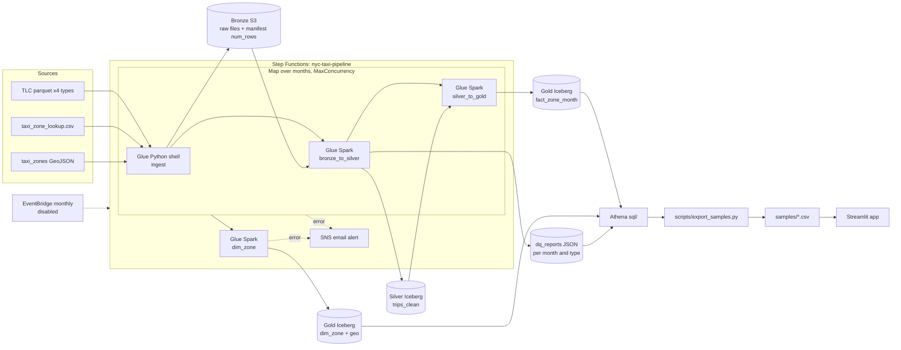

# NYC TLC Trip-Type Lakehouse — Submission 2 (Reproducible Pipeline)

## 1. โจทย์ เป้าหมาย และสมมติฐาน

**คำถามหลัก (ตามโจทย์):** ในครึ่งปีแรกของปี 2024 (ม.ค.–มิ.ย. 2024) รถประเภทไหนถูกใช้มากที่สุด

ประเภทที่ใช้มี 4 แบบ: `yellow`, `green`, `fhv`, `hvfhv`

- **"ประเภท"** หมายถึงประเภทของ trip record ที่ TLC เผยแพร่ ตามกฎหมาย FHV กับ HVFHV ไม่ใช่แท็กซี่ ผลทุกตัวจึงแสดงสองแบบ คือ **taxi-only** (yellow + green เหมือน S1) และ **all types** (ครบ 4 ประเภท)
- **"ถูกใช้มากที่สุด"** วัดจากจำนวนเที่ยว คือจำนวนแถวใน trip record ที่ผ่าน DQ แล้ว
- **ขอบเขตที่รัน:** pipeline ทำงานทีละเดือน และรองรับทุกเดือนตั้งแต่ **ก.พ. 2019** เป็นต้นไป ที่เริ่ม ก.พ. 2019 เพราะใบอนุญาตประเภท HVFHS มีผลวันที่ 1 ก.พ. 2019 (อ้างอิงจาก HVFHS data dictionary) ก่อนหน้านั้นเที่ยวของ Uber/Lyft ยังรวมอยู่ใน FHV จึงเอามาเทียบกันไม่ได้ แต่เพราะเวลาและงบของ Learner Lab มีจำกัด รอบนี้จึงรันจริงแค่ **H1 2024** (ดูหัวข้อ 11)

| #   | สมมติฐาน                                                                                                | ตอบด้วย                                      |
| --- | ------------------------------------------------------------------------------------------------------- | -------------------------------------------- |
| H1  | มีประเภทหนึ่งที่มีจำนวนเที่ยวรวมมากที่สุดใน H1 2024                                                     | `sql/q_h1.sql`, `sql/q_original_h1_2024.sql` |
| H2  | ประเภทที่นำเป็นประเภทเดิมทุกเดือนใน H1 2024                                                             | `sql/q_h2.sql`                               |
| H3  | คำตอบไม่เปลี่ยน ไม่ว่าจะดูแบบ taxi-only หรือ all types และไม่ว่าจะตัดเที่ยวแบบ shared/pooled ออกหรือไม่ | `sql/q_h3.sql`                               |
| H4  | กฎ DQ ไม่ได้ทำให้คำตอบเพี้ยน (เทียบจำนวนแถวดิบจาก footer กับจำนวนแถวที่ผ่าน DQ แยกตามเดือนและประเภท)    | `sql/q_h4.sql`                               |
| H5  | ประเภทที่นำแตกต่างกันไปตามพื้นที่                                                                       | `sql/q_h5.sql`, แผนที่ใน Streamlit           |

## 2. แหล่งข้อมูล

| แหล่ง                                         | รูปแบบ                             | URL                                                                                                                                                                                                                                                                                                                                 |
| --------------------------------------------- | ---------------------------------- | ----------------------------------------------------------------------------------------------------------------------------------------------------------------------------------------------------------------------------------------------------------------------------------------------------------------------------------- |
| Trip records ของ Yellow / Green / FHV / HVFHV | Parquet ไฟล์ละ 1 ประเภทต่อ 1 เดือน | `https://d37ci6vzurychx.cloudfront.net/trip-data/{yellow,green,fhv,fhvhv}_tripdata_YYYY-MM.parquet`                                                                                                                                                                                                                                 |
| Data dictionary                               | PDF                                | `data_dictionary_trip_records_{yellow,green,fhv,hvfhs}.pdf` (อยู่ใน repo)                                                                                                                                                                                                                                                           |
| Taxi zone lookup                              | CSV                                | `https://d37ci6vzurychx.cloudfront.net/misc/taxi_zone_lookup.csv`                                                                                                                                                                                                                                                                   |
| ขอบเขตของ taxi zone                           | GeoJSON                            | `https://data.cityofnewyork.us/api/geospatial/8meu-9t5y?method=export&format=GeoJSON` (NYC Open Data "NYC Taxi Zones" พิกัด WGS84 รหัสโซนอยู่ใน property `locationid` ตั้งค่าได้ที่ stack parameter `ZonesGeoJsonUrl`) ไฟล์ `taxi_zones.zip` ของ TLC เป็นโซนชุดเดียวกัน แต่เป็น Shapefile พิกัด EPSG:2263 ถ้าจะใช้ต้องแปลงพิกัดก่อน |

แต่ละประเภทตั้งชื่อคอลัมน์ไม่เหมือนกัน การจับคู่คอลัมน์เขียนไว้เป็นข้อมูลใน [`src/lib/taxi_types.py`](src/lib/taxi_types.py) และเทียบชื่อแบบไม่สนตัวพิมพ์เล็ก-ใหญ่

| คอลัมน์กลาง                                  | yellow                                                                                                       | green                              | fhv                    | hvfhv                                                                                                     |
| -------------------------------------------- | ------------------------------------------------------------------------------------------------------------ | ---------------------------------- | ---------------------- | --------------------------------------------------------------------------------------------------------- |
| `operator`                                   | `VendorID`                                                                                                   | `VendorID`                         | `dispatching_base_num` | `hvfhs_license_num`                                                                                       |
| `pickup_datetime`                            | `tpep_pickup_datetime`                                                                                       | `lpep_pickup_datetime`             | `pickup_datetime`      | `pickup_datetime`                                                                                         |
| `dropoff_datetime`                           | `tpep_dropoff_datetime`                                                                                      | `lpep_dropoff_datetime`            | `dropOff_datetime`     | `dropoff_datetime`                                                                                        |
| `pickup_location_id`                         | `PULocationID`                                                                                               | `PULocationID`                     | `PUlocationID`         | `PULocationID`                                                                                            |
| `is_shared`                                  | false                                                                                                        | false                              | `SR_Flag = 1`          | `shared_match_flag = 'Y'`                                                                                 |
| `passenger_count`                            | ✓                                                                                                            | ✓                                  | –                      | –                                                                                                         |
| `trip_distance`                              | `trip_distance`                                                                                              | `trip_distance`                    | –                      | `trip_miles`                                                                                              |
| ค่าโดยสาร (เก็บไว้ตามต้นฉบับ ไม่ได้ใช้เทียบ) | `fare_amount, tip_amount, total_amount, airport_fee (Airport_fee), congestion_surcharge, cbd_congestion_fee` | เหมือน yellow แต่ไม่มี airport fee | –                      | `base_passenger_fare, tolls, bcf, sales_tax, congestion_surcharge, airport_fee, tips, cbd_congestion_fee` |

## 3. สถาปัตยกรรม



**ลำดับการทำงาน** (ตัวอย่าง input `{"months":["2024-01", …], "taxi_types":[…]}`)

1. **สั่งรัน** — เรียก Step Functions เอง (`start-execution`) หรือให้ EventBridge เรียกทุกเดือน (ตอนนี้ปิดไว้)
2. **แยกทีละเดือน** — Map state แตกรายการเดือนออกเป็นงานย่อย รันพร้อมกันได้ครั้งละ `MaxConcurrency` เดือน (ค่าเริ่มต้น 3) แต่ละเดือนทำข้อ 3–5 ตามลำดับ
3. **Ingest → Bronze** (`ingest.py`) — ดาวน์โหลด parquet ของแต่ละประเภทในเดือนนั้น รวมถึง zone lookup และ GeoJSON ขึ้น S3 แบบไม่แก้ไข แล้วเขียน manifest ที่บันทึกจำนวนแถวต้นทาง
4. **Bronze → Silver** (`bronze_to_silver.py`) — แปลงคอลัมน์ของแต่ละประเภทให้เป็น schema เดียวกัน ตรวจ DQ แล้วเขียนรายงาน DQ ก่อน ถ้าผ่านเกณฑ์จึงเขียนแถวที่ผ่านลง `trips_clean` ถ้าไม่ผ่าน job จะ fail และไม่เขียนอะไรลง Silver
5. **Silver → Gold** (`silver_to_gold.py`) — นับจำนวนเที่ยวและเที่ยว shared ต่อ ประเภท × โซนต้นทาง ของเดือนนั้น ลง `fact_zone_month`
6. **Dim zone** (`dim_zone.py`) — หลังครบทุกเดือน สร้าง `dim_zone` (ชื่อโซนและ borough) ใหม่ทั้งตาราง และคัดลอก GeoJSON ไปไว้ใน `gold/geo/`
7. **ถ้าขั้นไหนพัง** — แต่ละ job retry ได้ 2 ครั้ง ถ้ายังพังอีกจะส่งอีเมลแจ้งผ่าน SNS แล้ว execution จบด้วยสถานะ Failed
8. **วิเคราะห์และนำเสนอ** (ทำเองหลัง pipeline เสร็จ ไม่อยู่ใน Step Functions) — query ใน `sql/` รันบน Athena → `export_samples.py` เขียนผลลง `samples/*.csv` → Streamlit อ่าน `samples/` ไปแสดงกราฟและแผนที่

- **Bronze** `s3://<bucket>/bronze/taxi_type=<t>/year=<y>/month=<mm>/<file>.parquet` เก็บไฟล์ดิบตามที่ดาวน์โหลดมา ไม่แก้อะไร ส่วน `manifest/year_month=<m>/manifest.json` บันทึกจำนวนแถว (`num_rows`) ที่อ่านจาก footer ของแต่ละไฟล์
- **Silver** `glue.nyc_taxi.trips_clean` แปลงทุกประเภทให้อยู่ใน schema เดียวกัน แบ่ง partition ตาม `months(pickup_datetime), taxi_type`
- **Gold** มีสองตาราง คือ `glue.nyc_taxi.fact_zone_month(year_month, taxi_type, pickup_location_id, trips, shared_trips)` และ `glue.nyc_taxi.dim_zone(location_id, borough, zone, service_zone)`
- **ประมวลผลทีละเดือน:** ทุก job รับ `--YEAR_MONTH` และเขียนทับเฉพาะ partition ของเดือนนั้นด้วย `overwritePartitions` รันซ้ำกี่รอบผลก็ออกมาเหมือนเดิม (idempotent) ถ้าส่ง `"latest"` เข้า state machine ขั้น ingest จะหาเดือนล่าสุดที่ TLC เผยแพร่ให้เอง
- **กรองเดือน:** ไฟล์ของ TLC มีเที่ยวที่ pickup ในเดือนอื่นปนมาด้วย Silver จึงเก็บเฉพาะเที่ยวที่ pickup อยู่ใน `--YEAR_MONTH` ที่เหลือนับเป็น reject `out_of_month` ถ้าไม่กรอง ตอนรันเดือน ก.พ. จะไปเขียนทับข้อมูลบางส่วนของเดือน ม.ค.
- **ทางสำรอง:** ถ้าใช้ Iceberg ไม่ได้ ตั้ง `TableFormat=parquet` แล้วระบบจะเขียนเป็น parquet แบบ Hive ใน layout เดียวกัน (`s3://<bucket>/parquet/<table>/year_month=…/taxi_type=…`)

## 4. โครงสร้าง repo

```
infra/            template.yaml (CloudFormation), deploy.sh, teardown.sh
orchestration/    state_machine.json (Step Functions, ใช้ DefinitionSubstitutions ของ CFN)
src/lib/          taxi_types.py (การจับคู่คอลัมน์และกฎ DQ ของแต่ละประเภท), job_utils.py (args, S3 JSON), lake.py (Spark/Iceberg)
src/ingestion/    ingest.py
src/transform/    bronze_to_silver.py, silver_to_gold.py, dim_zone.py
sql/              ddl.sql, q_original_h1_2024.sql, q_h1..q_h5.sql, q_dq_summary.sql, q_iceberg_snapshots.sql, q_silver_sample.sql
scripts/          export_samples.py (Athena -> samples/)
samples/          CSV ที่ export ออกมา + taxi_zones.geojson (commit ไว้ใน repo)
app/              streamlit_app.py (อ่านจาก samples/ ไม่ต้องต่อ AWS)
docs/evidence/    ภาพหน้าจอและไฟล์ที่ export จากการรัน
tests/            test_mapping.py
```

## 5. การติดตั้งและการรัน

> **ทุกคำสั่งด้านล่างเป็น bash**

### 5.0 ติดตั้งครั้งแรก (เครื่องตัวเอง)

สิ่งที่ต้องมี: AWS Academy Learner Lab (`us-east-1`), AWS CLI v2, Git Bash (Windows) หรือ bash อื่น, Python 3.10 ขึ้นไป

```bash
python -m venv .venv
```

```bash
source .venv/Scripts/activate   # Windows Git Bash; macOS/Linux ใช้ source .venv/bin/activate
```

```bash
pip install -r requirements.txt
```

### 5.1 ทุกครั้งที่เปิด Learner Lab: credentials และตัวแปร

**Credentials (ใส่ไว้ที่เดียวคือ `~/.aws/credentials`)** token ของ Learner Lab หมดอายุในราว 4 ชั่วโมง พอหมดแล้วทุกคำสั่ง AWS จะ error `ExpiredTokenException`

1. Learner Lab → **Start Lab** (รอจนจุดเป็นสีเขียว) → **AWS Details** → **AWS CLI: Show**
2. คัดลอก 3 บรรทัดใต้ `[default]` ไปวางใน `~/.aws/credentials` ทับของเดิม
3. ตรวจว่าใช้ได้:

```bash
aws sts get-caller-identity
```

AWS CLI, `infra/*.sh` และ `scripts/export_samples.py` อ่านจากไฟล์นี้ไฟล์เดียวกัน อย่าเอา key ไปใส่ใน `.env` หรือ `export AWS_...` เพราะ environment variable จะถูกใช้ก่อนไฟล์ ถ้ามี token เก่าค้างอยู่ใน env จะ error ต่อไปเรื่อยๆ ถึงจะอัปเดตไฟล์แล้วก็ตาม ถ้าเคยตั้งไว้ ให้ล้างออก:

```bash
unset AWS_ACCESS_KEY_ID AWS_SECRET_ACCESS_KEY AWS_SESSION_TOKEN
```

**ตัวแปร (ต้องตั้งใหม่ทุกครั้งที่เปิดหน้าต่าง Git Bash ใหม่)** ชื่อ bucket ต้องไม่ซ้ำกับใครทั้งโลก จึงต้องเติม suffix:

```bash
export BUCKET=nyc-taxi-lake-<suffix> ATHENA_BUCKET=nyc-taxi-athena-<suffix> ALERT_EMAIL=<you@example.com>
```

```bash
export LAB_ROLE_ARN=arn:aws:iam::$(aws sts get-caller-identity --query Account --output text):role/LabRole
```

### 5.2 Deploy

```bash
aws cloudformation validate-template --template-body file://infra/template.yaml
```

```bash
infra/deploy.sh
```

`deploy.sh` จะ deploy stack และ sync `src/` ขึ้นไปที่ `s3://$BUCKET/scripts/` จากนั้นให้กดยืนยัน subscription ในอีเมลที่ SNS ส่งมา แล้วเก็บ ARN ของ state machine ไว้ (`start-execution` ต้องใช้ ARN เต็ม ใช้ชื่อเฉยๆ ไม่ได้):

```bash
export SFN_ARN=$(aws cloudformation describe-stacks --stack-name nyc-taxi-pipeline --query "Stacks[0].Outputs[?OutputKey=='StateMachineArn'].OutputValue" --output text)
```

### 5.3 รัน pipeline

1. **Smoke test** (green เดือนเดียว) ดูความคืบหน้าได้ใน Step Functions console ถ้าพังที่ Iceberg ให้ deploy ใหม่ด้วย `TABLE_FORMAT=parquet infra/deploy.sh`

```bash
aws stepfunctions start-execution --state-machine-arn "$SFN_ARN" --input '{"months":["2024-01"],"taxi_types":["green"]}'
```

2. **H1 2024 ครบ 4 ประเภท** (ชุดที่ใช้ตอบโจทย์) รันเสร็จแล้วให้เก็บหลักฐานลง `docs/evidence/` ทันที

```bash
aws stepfunctions start-execution --state-machine-arn "$SFN_ARN" --input '{"months":["2024-01","2024-02","2024-03","2024-04","2024-05","2024-06"],"taxi_types":["yellow","green","fhv","hvfhv"]}'
```

3. **ถ้าจะรันเดือนอื่นเพิ่ม (ไม่บังคับ)** เดือนไหนก็ได้ตั้งแต่ `2019-02` ใช้คำสั่งแบบเดียวกัน หรือใส่ `"latest"` เพื่อเอาเดือนล่าสุด แต่ถ้าจะให้ผลวิเคราะห์ครอบคลุมเดือนเหล่านั้นด้วย ต้องขยายเงื่อนไข `year_month` ใน `sql/q_h*.sql` และ `sql/q_dq_summary.sql`

### 5.4 Export ผลลัพธ์ → `samples/`

ต้องมี credentials ที่ยังไม่หมดอายุ (ดู 5.1) สคริปต์นี้รัน query ใน `sql/` บน Athena แล้วเขียนผลลง `samples/*.csv` และ `samples/taxi_zones.geojson` เสร็จแล้วให้ commit โฟลเดอร์ `samples/`

```bash
python scripts/export_samples.py --bucket "$BUCKET" --athena-results-bucket "$ATHENA_BUCKET"
```

### 5.5 Dashboard และ test (ไม่ต้องต่อ AWS)

Dashboard อ่านข้อมูลจาก `samples/` ที่ได้จากข้อ 5.4

- Dashboard ออนไลน์: _todo: ใส่ลิงก์ Streamlit Community Cloud_ (ถ้าไม่มีคนเข้านานๆ app จะถูกพักไว้ ตอนเปิดให้กดปุ่มปลุกแล้วรอสักครู่)
- รันในเครื่อง:

```bash
streamlit run app/streamlit_app.py
```

```bash
python -m pytest tests
```

### 5.6 ลบ resource ทั้งหมด

```bash
infra/teardown.sh
```

## 6. คุณภาพข้อมูล (Data quality)

กฎ DQ เขียนไว้เป็นข้อมูลใน [`src/lib/taxi_types.py`](src/lib/taxi_types.py) และถูกใช้ใน `bronze_to_silver.py` กฎข้อไหนใช้กับประเภทนั้นไม่ได้ (เช่น fhv ไม่มีค่าโดยสาร) จะรายงานเป็น `null` ไม่ใช่ `0` เพื่อไม่ให้เข้าใจผิดว่าตรวจแล้วไม่เจอ

| กฎ                                                                                       | ชนิด   | yellow          | green           | fhv  | hvfhv |
| ---------------------------------------------------------------------------------------- | ------ | --------------- | --------------- | ---- | ----- |
| `out_of_month` (pickup อยู่นอก `--YEAR_MONTH` หรือเป็น null)                             | reject | ✓               | ✓               | ✓    | ✓     |
| `dropoff_before_pickup` (`dropoff <= pickup`)                                            | reject | ✓               | ✓               | ✓    | ✓     |
| `negative_amount` (`fare_amount`/`total_amount` < 0, hvfhv ดู `base_passenger_fare` < 0) | reject | ✓               | ✓               | null | ✓     |
| `negative_distance`                                                                      | reject | ✓               | ✓               | null | ✓     |
| `passenger_count_invalid` (null หรือ ≤ 0)                                                | flag   | ✓               | ✓               | null | null  |
| `pickup_location_null`                                                                   | flag   | ✓               | ✓               | ✓    | ✓     |
| `shared`                                                                                 | flag   | ✓ (เป็น 0 เสมอ) | ✓ (เป็น 0 เสมอ) | ✓    | ✓     |

**reject** คือตัดแถวนั้นออกจาก Silver ส่วน **flag** คือเก็บแถวไว้แต่นับแยกไว้ในรายงาน

- **รายงาน DQ** แยกตามเดือนและประเภท อยู่ที่ `s3://<bucket>/dq_reports/year_month=<m>/taxi_type=<t>/report.json` และพิมพ์เป็นบรรทัด `[DQ]` ใน CloudWatch ด้วย query ผ่าน Athena ได้ที่ตาราง `nyc_taxi.dq_reports` (สร้างใน `sql/ddl.sql`)
- **เกณฑ์ไม่ผ่าน:** job จะ fail ถ้า `written_rows == 0` หรือ `reject_rate > MAX_REJECT_RATE` (ค่าเริ่มต้น 0.10) ระบบเขียนรายงานก่อนเสมอ และเดือนที่ไม่ผ่านจะไม่ถูกเขียนลง Silver
- **สรุปรวม:** `samples/dq_summary.csv` (จาก `sql/q_dq_summary.sql`)
- **กระทบยอด (H4):** `samples/answer_h4.csv` เทียบจำนวนแถวจาก footer, จำนวนแถวที่เขียนลง Silver และจำนวนเที่ยวใน Gold แยกตามเดือนและประเภท

## 7. ผลลัพธ์

ตัวเลขทั้งหมดมาจาก `samples/` (export ด้วย `scripts/export_samples.py` หลังรัน H1 2024 ครบ 4 ประเภท)

### คำถามหลัก — H1 2024 (ม.ค.–มิ.ย. 2024)

**คำตอบ: HVFHV (Uber/Lyft) ถูกใช้มากที่สุด ราว 81% ของเที่ยวทั้งหมด ถ้านับเฉพาะแท็กซี่ (แบบ S1) yellow ถูกใช้มากที่สุด**

ที่มา: [`samples/answer_original_h1_2024.csv`](samples/answer_original_h1_2024.csv)

| อันดับ | ครบ 4 ประเภท (`all_types`) | จำนวนเที่ยว | สัดส่วน |     | Taxi only (`taxi_only`) | จำนวนเที่ยว | สัดส่วน |
| ------ | -------------------------- | ----------: | ------: | --- | ----------------------- | ----------: | ------: |
| 1      | hvfhv                      | 120,853,735 |  80.94% |     | yellow                  |  20,009,098 |  98.34% |
| 2      | yellow                     |  20,009,098 |  13.40% |     | green                   |     338,249 |   1.66% |
| 3      | fhv                        |   8,119,228 |   5.44% |     |                         |             |         |
| 4      | green                      |     338,249 |   0.23% |     |                         |             |         |

### H1–H5

| #   | สมมติฐาน                          | ผล                                                                                                                                                                                                            | ไฟล์                                                                                 |
| --- | --------------------------------- | ------------------------------------------------------------------------------------------------------------------------------------------------------------------------------------------------------------- | ------------------------------------------------------------------------------------ |
| H1  | มีประเภทหนึ่งที่นำในยอดรวม        | **จริง** hvfhv นำ (ตารางด้านบน)                                                                                                                                                                               | [`answer_h1.csv`](samples/answer_h1.csv)                                             |
| H2  | ประเภทที่นำเป็นประเภทเดิมทุกเดือน | **จริง** hvfhv นำทั้ง 6 เดือน (19.4M–21.3M เที่ยว/เดือน) และ yellow นำทั้ง 6 เดือนในแบบ taxi-only                                                                                                             | [`answer_h2.csv`](samples/answer_h2.csv)                                             |
| H3  | คำตอบไม่เปลี่ยนเมื่อเปลี่ยนนิยาม  | **จริง** ทั้ง 4 แบบ (taxi-only/all types × รวม/ไม่รวม shared) อันดับไม่เปลี่ยน ตัดเที่ยว shared ออกแล้ว hvfhv เหลือ 119,245,325 ก็ยังเป็นอันดับ 1                                                             | [`answer_h3.csv`](samples/answer_h3.csv)                                             |
| H4  | กฎ DQ ไม่ได้ทำให้คำตอบเพี้ยน      | **จริง** ทั้ง 24 ชุด (6 เดือน × 4 ประเภท) ผ่าน DQ (`PASS`) และจำนวนใน Gold ตรงกับ Silver ทุกชุด reject สูงสุดคือ yellow 1.59% (ส่วนใหญ่เป็น `negative_amount`) ซึ่งน้อยกว่าช่องห่างระหว่างอันดับมาก           | [`answer_h4.csv`](samples/answer_h4.csv), [`dq_summary.csv`](samples/dq_summary.csv) |
| H5  | ประเภทที่นำแตกต่างกันไปตามพื้นที่ | **จริงเพียงเล็กน้อย** แบบ all types hvfhv นำ 259 จาก 263 โซน ยกเว้น Central Park และโซน Unknown (yellow นำ) กับ Newark Airport และ Outside of NYC (fhv นำ) แบบ taxi-only yellow นำ 253 โซน และ green นำ 9 โซน | [`answer_h5.csv`](samples/answer_h5.csv) + แผนที่ใน app                              |

### สรุป DQ รายประเภท (H1 2024)

ที่มา: [`samples/dq_summary.csv`](samples/dq_summary.csv) (ช่องว่างหมายถึงกฎข้อนั้นใช้กับประเภทนั้นไม่ได้)

| ประเภท | แถวดิบ (footer) | เขียนลง Silver | reject rate | reject หลัก                                              | flag ที่ควรรู้                          |
| ------ | --------------: | -------------: | ----------: | -------------------------------------------------------- | --------------------------------------- |
| yellow |      20,332,093 |     20,009,098 |       1.59% | `negative_amount` 316,694, `dropoff_before_pickup` 6,177 | `passenger_count_invalid` 2,197,094     |
| green  |         339,807 |        338,249 |       0.46% | `negative_amount` 1,187, `dropoff_before_pickup` 335     | `passenger_count_invalid` 17,336        |
| fhv    |       8,119,228 |      8,119,228 |       0.00% | –                                                        | `pickup_location_null` 6,359,783 (~78%) |
| hvfhv  |     120,864,668 |    120,853,735 |       0.01% | `negative_amount` 10,921                                 | `shared` 1,608,546                      |

## 8. หลักฐานการรัน (`docs/evidence/`)

**การรันที่ใช้ตอบโจทย์:** execution `dea9a917-41af-41a4-938a-7afe780efe29` ของ state machine `nyc-taxi-pipeline` input คือ 6 เดือน (2024-01 ถึง 2024-06) × 4 ประเภท สถานะ **Succeeded** รันวันที่ 15 พ.ย. 2026 เวลา 17:43–17:57 (UTC+7) ใช้เวลา 14 นาที


| หลักฐาน                                                             | ไฟล์                                                                                                                                |
| ------------------------------------------------------------------- | ----------------------------------------------------------------------------------------------------------------------------------- |
| กราฟ Step Functions ที่สำเร็จ (สถานะ, เวลา, graph view)             | [`หลักฐานการรัน step function 1.png`](docs/evidence/หลักฐานการรัน%20step%20function%201.png)                                        |
| input/output ของ execution (6 เดือน × 4 ประเภท)                     | [`หลักฐานการรัน step function 2.png`](docs/evidence/หลักฐานการรัน%20step%20function%202.png)                                        |
| ผล DQ และการกระทบยอดทุกเดือน × ประเภท (24 แถว `PASS`)               | [`samples/answer_h4.csv`](samples/answer_h4.csv), [`samples/dq_summary.csv`](samples/dq_summary.csv) (export จากตาราง `dq_reports`) |
| ตัวอย่างข้อมูลใน Silver และ Gold                                    | [`samples/silver_sample_100.csv`](samples/silver_sample_100.csv), [`samples/fact_zone_month.csv`](samples/fact_zone_month.csv)      |
| บรรทัด `[DQ]` ใน CloudWatch เดือน 2024-05 (4 ประเภท)                | [`cloudwatch log 2024-05 (1–4).png`](docs/evidence/cloudwatch%20log%202024-05%20%281%29.png) (ไฟล์ `(1)` ถึง `(4)`)                 |
| บรรทัด `[DQ]` ตอนรัน 2024-05 ซ้ำ                                    | [`cloudwatch log 2024-05 rerun (1–4).png`](docs/evidence/cloudwatch%20log%202024-05%20rerun%20%281%29.png) (ไฟล์ `(1)` ถึง `(4)`)   |
| Iceberg snapshots ของ `trips_clean` (`sql/q_iceberg_snapshots.sql`) | [`Iceberg results.png`](docs/evidence/Iceberg%20results.png)                                                                        |

|

### หลักฐานการรันซ้ำ (idempotency)

รันเดือน 2024-05 ซ้ำ (15 พ.ย. 21:04 เวลาไทย) หลังรันครั้งแรกไปแล้ว (17:52) เพื่อยืนยันว่ารันซ้ำแล้วข้อมูลไม่ซ้ำและผลไม่เปลี่ยน

- **CloudWatch:** รายงาน `[DQ]` ของ yellow 2024-05 ทั้งสองรอบ มาจาก Glue run คนละตัว (`run_id` ต่างกัน) แต่ตัวเลขเหมือนกันทุกช่อง คือ `source_rows_footer` 3,723,833, `written_rows` 3,662,517 และ `reject_rate` 0.016466 ทั้งสองรอบ
- **Iceberg snapshots:** snapshot ของรอบที่สองเป็น `overwrite` ที่ **ลบ 25,780,005 แถวและเพิ่ม 25,780,005 แถว** ใน 4 partition (2024-05 × 4 ประเภท) ยอดนี้เท่ากับผลรวม `written_rows` ของเดือน พ.ค. ใน `answer_h4.csv` แปลว่า `overwritePartitions` แทนที่เฉพาะเดือนนั้น ไม่ได้ต่อท้ายจนข้อมูลซ้ำ
- smoke test green 2024-01 ที่รัน 3 รอบก่อนหน้า (snapshot ลบ/เพิ่ม 56,289 แถว) ก็ให้ผลแบบเดียวกัน และตอนรัน H1 2024 เดือน ม.ค. snapshot ลบแค่ 56,289 แถว ซึ่งคือ partition green ม.ค. เดิม ส่วนเดือนอื่นไม่ถูกแตะ


เวลาใน snapshot เป็น UTC (บวก 7 ชั่วโมงเป็นเวลาไทย) แถวละ 1 commit ของ Silver job คือ 1 เดือน

## 9. การตัดสินใจในการออกแบบ

> _todo: เขียนด้วยคำของตัวเอง_

- **วัด "ถูกใช้มากที่สุด" ด้วยจำนวนเที่ยว ครบ 4 ประเภทใน H1 2024:** _ประเด็น: ค่าโดยสารแต่ละประเภทนิยามไม่เหมือนกันจึงเทียบไม่ได้; เก็บ view taxi-only ไว้เทียบกับ S1; pipeline รองรับตั้งแต่ ก.พ. 2019 เพราะใบอนุญาต HVFHS เริ่ม 1 ก.พ. 2019_
- **ประมวลผลทีละเดือน + กรองเดือน:** _ประเด็น: `overwritePartitions` ทำให้รันซ้ำได้; session ของ Learner Lab มีแค่ 4 ชม. จึงต้องแบ่งรันเป็นช่วงและต่อจากที่ค้างได้; ถ้าไม่กรอง เที่ยวข้ามเดือนจะไปทับเดือนข้างเคียง_
- **Iceberg แทน Hive parquet:** _ประเด็น: commit แบบ atomic; ไม่ต้อง MSCK REPAIR; snapshot ใช้เป็นหลักฐานการรันได้; มีสวิตช์สำรองเป็น parquet_
- **DQ แบบ flag/รายงาน แทนการตัดทิ้งเงียบๆ:** _ประเด็น: ใน S1 กรอง `passenger_count > 0` ทำให้นับเที่ยวขาด; กฎแต่ละข้อใช้ได้ไม่เหมือนกันในแต่ละประเภท; มีเกณฑ์ให้ job fail_
- **Gold เก็บเฉพาะตัวชี้วัดที่ใช้ตอบคำถาม:** _ประเด็น: ทำไมตัด KPI รายได้/ทิป/ระยะทางออก_
- **CloudFormation:** _ประเด็น: CDK bootstrap ต้องสร้าง IAM role ซึ่ง Learner Lab ไม่อนุญาต_
- **Streamlit:** _ประเด็น: อ่านจาก samples ที่ commit ไว้ ไม่ต้องใช้ credential และไม่มีค่าใช้จ่าย_

## 10. Submission 1 → Submission 2

| ด้าน          | S1 (notebook + baseline code)                                                       | S2                                                                                                                                |
| ------------- | ----------------------------------------------------------------------------------- | --------------------------------------------------------------------------------------------------------------------------------- |
| ขอบเขต        | yellow + green, H1 2024                                                             | 4 ประเภท, รัน H1 2024 และรองรับทุกเดือนตั้งแต่ ก.พ. 2019                                                                          |
| Ingest        | hardcode bucket และเดือน; HTTP error แล้วยัง exit 0; ข้ามไฟล์แค่เพราะมีไฟล์อยู่แล้ว | รับค่าผ่าน args ทั้งหมด; error แล้ว exit non-zero; ข้ามไฟล์เมื่อขนาดตรงกับต้นทางเท่านั้น; บันทึกจำนวนแถวจาก footer ไว้ใน manifest |
| Schema        | อ่านด้วย glob ข้ามหลายเดือน; บั๊ก `airport_fee` เพราะเทียบตัวพิมพ์เล็ก-ใหญ่         | จับคู่คอลัมน์ต่อประเภทแบบเป็นข้อมูล ไม่สนตัวพิมพ์ และ cast ทีละไฟล์                                                               |
| DQ            | กรองทิ้งเงียบๆ (รวม `passenger_count > 0`)                                          | reject + flag ตามประเภท, รายงาน JSON, มีเกณฑ์ fail                                                                                |
| การจัดเก็บ    | parquet เขียนทับทั้งตาราง                                                           | Iceberg เขียนทับทีละเดือนด้วย `overwritePartitions`                                                                               |
| Gold          | KPI รายได้/ทิป/ระยะทาง                                                              | `trips`, `shared_trips` เท่านั้น                                                                                                  |
| Orchestration | 2 job รันต่อกัน + MSCK REPAIR                                                       | Map ทีละเดือน มี retry/timeout, แจ้งเตือน SNS, schedule                                                                           |
| Infra         | กดสร้างใน console เอง                                                               | CloudFormation                                                                                                                    |
| การนำเสนอ     | กราฟใน notebook                                                                     | SQL ต่อสมมติฐาน, samples ที่ export, แผนที่ใน Streamlit                                                                           |

## 11. ข้อจำกัด

- **รันจริงแค่ H1 2024** ถ้าจะ backfill ตั้งแต่ ก.พ. 2019 (ราว 90 เดือน) ประเมินไว้ว่าใช้เวลา Glue ประมาณ 7–10 ชั่วโมง และค่าใช้จ่ายราว $30–50 ซึ่งไม่พอกับ session 4 ชั่วโมงและงบของ Learner Lab ก่อนกำหนดส่ง โค้ดรองรับเดือนอื่นอยู่แล้ว แค่ต้องขยายเงื่อนไข `year_month` ใน SQL
- **ไม่รวมข้อมูลก่อนปี 2019** เพราะตอนนั้นยังไม่มี HVFHV และ Uber/Lyft ยังอยู่ใน FHV จึงเทียบประเภทกันไม่ได้ ในทางเทคนิค ช่วง 2011-01 ถึง 2019-01 รันได้ถ้าตัด `hvfhv` ออก (parquet ของ TLC ปัจจุบันมี `PULocationID` แล้ว) แต่ yellow ปี 2009–2010 ใช้ชื่อคอลัมน์อื่นและมีแค่ lat/lon ทำให้ Silver พัง
- เที่ยวที่มาช้าและไปอยู่ในไฟล์ของเดือนอื่นจะถูกตัดทิ้ง (`out_of_month`)
- ความหมายของหนึ่งแถวไม่เท่ากัน แท็กซี่ 1 แถวคือ 1 เที่ยวที่กดมิเตอร์ ส่วน FHV/HVFHV 1 แถวคือ 1 การจอง เที่ยวแบบ pooled จึงนับตามจำนวนการจองของผู้โดยสาร
- Lyft (base B02510, B02844) ตั้ง `SR_Flag` เกินจริง เพราะนับคำขอ shared ที่จับคู่ไม่สำเร็จไปด้วย `shared_trips` ของ FHV จึงเป็นค่าสูงสุดที่เป็นไปได้ ไม่ใช่ค่าจริง
- FHV มี `PUlocationID` เป็น null ค่อนข้างมาก เที่ยวเหล่านี้ยังนับรวมในยอด แต่ไม่ได้แสดงบนแผนที่ (H5)
- ไม่ได้เทียบรายได้ เพราะแต่ละประเภทนิยามค่าโดยสารไม่เหมือนกัน
- ยังไม่มีงานดูแล Iceberg (compaction, ลบ snapshot เก่า)
- ข้อจำกัดของ Learner Lab: ใช้ได้แค่ LabRole, session ละ 4 ชั่วโมง, มีเพดานงบ และ schedule จะทำงานได้ก็ต่อเมื่อ LabRole อนุญาตให้ EventBridge เรียกใช้

## 12. งานที่ทำต่อได้

- เทียบรายได้โดยปรับนิยามค่าโดยสารให้เป็นแบบเดียวกันก่อน
- แยก HVFHV ตามบริษัท (`hvfhs_license_num` อยู่ใน Silver แล้วในคอลัมน์ `operator`)
- รองรับ yellow ปี 2009–2010: เพิ่มชื่อคอลัมน์สำรองใน `COLUMN_MAP` และทำ spatial join จาก lat/lon ไปเป็นโซน
- ตัวชี้วัดเวลารอรถ (`request_datetime`, `on_scene_datetime`)

## 13. สิ่งที่ได้เรียนรู้

> _todo: เขียนเอง 3–5 ประโยค_
