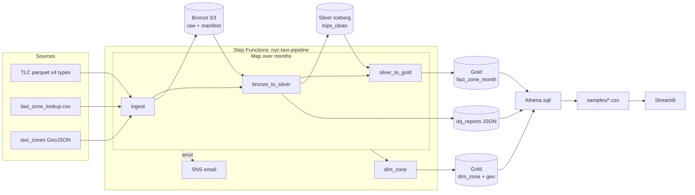

# NYC TLC Trip-Type Lakehouse — Submission 2

**โจทย์:** ครึ่งปีแรก 2024 (ม.ค.–มิ.ย.) รถประเภทไหนถูกใช้มากที่สุด — `yellow`, `green`, `fhv`, `hvfhv`

**คำตอบ:** **HVFHV (Uber/Lyft) ~81% ของเที่ยวทั้งหมด** · ถ้านับเฉพาะแท็กซี่ (แบบ S1) **yellow 98%**

**Dashboard:** https://nyc-taxi-pipeline-d2lybexmuy8gf8dsgmzbha.streamlit.app/

**Stack:** S3 · Glue (Python shell + Spark) · Iceberg · Step Functions · Athena · CloudFormation · Streamlit

### สารบัญตามเกณฑ์

| เกณฑ์ (คะแนน)                         | ดูที่                                                                      |
| ------------------------------------- | -------------------------------------------------------------------------- |
| เตรียม จัดการ จัดเก็บข้อมูล (20)      | [§1 ข้อมูล](#1-ข้อมูลที่ใช้), [§2 Pipeline](#2-pipeline)                   |
| เชื่อมหลายแหล่ง + curated output (20) | [§2 Pipeline](#2-pipeline), [§6 ตัวอย่างข้อมูล](#6-ตัวอย่างข้อมูลพร้อมใช้) |
| รันซ้ำ / อัปเดตข้อมูลใหม่ได้ (15)     | [§4 หลักฐานการรัน](#4-หลักฐานการรัน)                                       |
| Data quality + หลักฐานการทำงาน (15)   | [§4](#4-หลักฐานการรัน), [§5 DQ](#5-ผลตรวจคุณภาพข้อมูล)                     |
| บูรณาการ/ประมวลผลเป็นตัวชี้วัด (15)   | [§7 ผลวิเคราะห์](#7-ผลวิเคราะห์-h1h5)                                      |
| นำเสนอเข้าใจง่าย ตรวจย้อนกลับได้ (15) | [§7](#7-ผลวิเคราะห์-h1h5) (ทุกตัวเลขลิงก์ไป CSV + SQL), Dashboard          |

---

## 1. ข้อมูลที่ใช้

| แหล่ง                 | รูปแบบ                        | ที่มา                                                                                               |
| --------------------- | ----------------------------- | --------------------------------------------------------------------------------------------------- |
| Trip records 4 ประเภท | Parquet (1 ไฟล์/ประเภท/เดือน) | `https://d37ci6vzurychx.cloudfront.net/trip-data/{yellow,green,fhv,fhvhv}_tripdata_YYYY-MM.parquet` |
| Taxi zone lookup      | CSV                           | `https://d37ci6vzurychx.cloudfront.net/misc/taxi_zone_lookup.csv`                                   |
| ขอบเขตโซน (แผนที่)    | GeoJSON                       | NYC Open Data "NYC Taxi Zones" (`8meu-9t5y`)                                                        |
| Data dictionary       | PDF                           | `data_dictionary_trip_records_*.pdf` ใน repo                                                        |

**นิยาม:** "ถูกใช้มากที่สุด" = จำนวนเที่ยว (แถวที่ผ่าน DQ) · แสดงผล 2 มุม: **taxi-only** (yellow+green เหมือน S1) และ **all types** เพราะตามกฎหมาย FHV/HVFHV ไม่ใช่แท็กซี่

**ขอบเขต:** pipeline รองรับทุกเดือนตั้งแต่ **ก.พ. 2019** (ใบอนุญาต HVFHS เริ่มมีผล — ก่อนนั้น Uber/Lyft ปนอยู่ใน FHV) แต่รันจริงเฉพาะ **H1 2024** เพราะงบ/เวลา Learner Lab

<details>
<summary>การจับคู่คอลัมน์ของแต่ละประเภท → schema กลาง (กดเพื่อดู)</summary>

นิยามเป็นข้อมูลใน [`src/lib/taxi_types.py`](src/lib/taxi_types.py) เทียบชื่อแบบไม่สนตัวพิมพ์

| คอลัมน์กลาง          | yellow                  | green                   | fhv                    | hvfhv                     |
| -------------------- | ----------------------- | ----------------------- | ---------------------- | ------------------------- |
| `operator`           | `VendorID`              | `VendorID`              | `dispatching_base_num` | `hvfhs_license_num`       |
| `pickup_datetime`    | `tpep_pickup_datetime`  | `lpep_pickup_datetime`  | `pickup_datetime`      | `pickup_datetime`         |
| `dropoff_datetime`   | `tpep_dropoff_datetime` | `lpep_dropoff_datetime` | `dropOff_datetime`     | `dropoff_datetime`        |
| `pickup_location_id` | `PULocationID`          | `PULocationID`          | `PUlocationID`         | `PULocationID`            |
| `is_shared`          | false                   | false                   | `SR_Flag = 1`          | `shared_match_flag = 'Y'` |
| `trip_distance`      | `trip_distance`         | `trip_distance`         | –                      | `trip_miles`              |

</details>

## 2. Pipeline



| Layer  | ตาราง / ที่เก็บ                                                   | ทำอะไร                                                               |
| ------ | ----------------------------------------------------------------- | -------------------------------------------------------------------- |
| Bronze | `s3://<bucket>/bronze/taxi_type=/year=/month=/` + `manifest.json` | ไฟล์ดิบไม่แก้ + จำนวนแถวจาก parquet footer (ใช้กระทบยอด)             |
| Silver | `nyc_taxi.trips_clean` (Iceberg, partition `month, taxi_type`)    | รวม 4 ประเภทเป็น schema เดียว + ตรวจ DQ                              |
| Gold   | `nyc_taxi.fact_zone_month`, `nyc_taxi.dim_zone`                   | จำนวนเที่ยว/เที่ยว shared ต่อ เดือน × ประเภท × โซน + ชื่อโซน/borough |

- **ทีละเดือน + idempotent:** ทุก job รับ `--YEAR_MONTH` และเขียนทับเฉพาะ partition เดือนนั้น (`overwritePartitions`) → รันซ้ำผลเท่าเดิม · ส่ง `"latest"` ได้เพื่อดึงเดือนล่าสุด
- **ล้มเหลว:** retry 2 ครั้ง → SNS email → execution `Failed` · EventBridge รายเดือนเตรียมไว้ (ปิดอยู่)

<details>
<summary>โครงสร้าง repo</summary>

```
infra/          template.yaml (CloudFormation), deploy.sh, teardown.sh
orchestration/  state_machine.json
src/lib/        taxi_types.py (column map + กฎ DQ), job_utils.py, lake.py
src/ingestion/  ingest.py
src/transform/  bronze_to_silver.py, silver_to_gold.py, dim_zone.py
sql/            ddl.sql, q_h1..q_h5.sql, q_dq_summary.sql, q_iceberg_snapshots.sql, ...
scripts/        export_samples.py (Athena → samples/)
samples/        ผลที่ export + taxi_zones.geojson
app/            streamlit_app.py (อ่าน samples/ ไม่ต้องต่อ AWS)
docs/evidence/  ภาพหน้าจอการรัน
tests/          test_mapping.py
```

</details>

## 3. ติดตั้งและรัน

ต้องมี: AWS Academy Learner Lab (`us-east-1`), AWS CLI v2, bash (Git Bash บน Windows), Python ≥ 3.10

**ดูผลอย่างเดียว (ไม่ต้องมี AWS)**

```bash
pip install -r requirements.txt
```

```bash
streamlit run app/streamlit_app.py
```

```bash
python -m pytest tests
```

**รัน pipeline เต็ม**

1. ใส่ credentials ของ Learner Lab ใน `~/.aws/credentials` (อย่าตั้งใน env — token เก่าใน env จะถูกใช้ก่อน) แล้วตั้งตัวแปร:

```bash
export BUCKET=nyc-taxi-lake-<suffix> ATHENA_BUCKET=nyc-taxi-athena-<suffix> ALERT_EMAIL=<you@example.com>
```

```bash
export LAB_ROLE_ARN=arn:aws:iam::$(aws sts get-caller-identity --query Account --output text):role/LabRole
```

2. Deploy (stack + upload `src/`) แล้วกดยืนยันอีเมล SNS:

```bash
infra/deploy.sh
```

```bash
export SFN_ARN=$(aws cloudformation describe-stacks --stack-name nyc-taxi-pipeline --query "Stacks[0].Outputs[?OutputKey=='StateMachineArn'].OutputValue" --output text)
```

3. รัน H1 2024 ครบ 4 ประเภท (smoke test: ใส่ `["2024-01"]` กับ `["green"]` ก่อนได้):

```bash
aws stepfunctions start-execution --state-machine-arn "$SFN_ARN" --input '{"months":["2024-01","2024-02","2024-03","2024-04","2024-05","2024-06"],"taxi_types":["yellow","green","fhv","hvfhv"]}'
```

4. Export ผลจาก Athena → `samples/`:

```bash
python scripts/export_samples.py --bucket "$BUCKET" --athena-results-bucket "$ATHENA_BUCKET"
```

5. ลบ resource:

```bash
infra/teardown.sh
```

> Iceberg ใช้ไม่ได้ → `TABLE_FORMAT=parquet infra/deploy.sh` (fallback เป็น Hive parquet layout เดียวกัน)

## 4. หลักฐานการรัน

**รันจริง:** execution `dea9a917-41af-41a4-938a-7afe780efe29` · 6 เดือน × 4 ประเภท · **Succeeded** · 15 พ.ย. 2026 17:43–17:57 (14 นาที)


**รันซ้ำ (idempotency):** รัน 2024-05 ซ้ำตอน 21:04

- CloudWatch `[DQ]` yellow 2024-05 ทั้งสองรอบ `run_id` ต่างกันแต่ตัวเลขเท่ากันทุกช่อง (footer 3,723,833 · written 3,662,517 · reject 1.65%)
- Iceberg snapshot รอบสองเป็น `overwrite` **ลบ 25,780,005 / เพิ่ม 25,780,005 แถว** = ยอด พ.ค. ทั้งเดือนพอดี → แทนที่ ไม่ได้ต่อท้ายซ้ำ


| หลักฐานเพิ่มเติม                   | ไฟล์                                                                                                   |
| ---------------------------------- | ------------------------------------------------------------------------------------------------------ |
| input/output ของ execution         | [`step function 2.png`](docs/evidence/หลักฐานการรัน%20step%20function%202.png)                         |
| CloudWatch `[DQ]` 2024-05 (รอบแรก) | [`cloudwatch log 2024-05 (1–4)`](docs/evidence/cloudwatch%20log%202024-05%20%281%29.png)               |
| CloudWatch `[DQ]` 2024-05 (รันซ้ำ) | [`cloudwatch log 2024-05 rerun (1–4)`](docs/evidence/cloudwatch%20log%202024-05%20rerun%20%281%29.png) |

## 5. ผลตรวจคุณภาพข้อมูล

กฎอยู่ใน [`src/lib/taxi_types.py`](src/lib/taxi_types.py) · **reject** = ตัดออกจาก Silver · **flag** = เก็บไว้แต่นับในรายงาน · กฎที่ใช้กับประเภทนั้นไม่ได้รายงานเป็น `null` (ไม่ใช่ 0)

| กฎ                        | ชนิด   | ใช้กับ               |
| ------------------------- | ------ | -------------------- |
| `out_of_month`            | reject | ทุกประเภท            |
| `dropoff_before_pickup`   | reject | ทุกประเภท            |
| `negative_amount`         | reject | yellow, green, hvfhv |
| `negative_distance`       | reject | yellow, green, hvfhv |
| `passenger_count_invalid` | flag   | yellow, green        |
| `pickup_location_null`    | flag   | ทุกประเภท            |
| `shared`                  | flag   | fhv, hvfhv           |

**Gate:** job fail ถ้า `written_rows == 0` หรือ `reject_rate > 10%` — เขียนรายงานก่อนเสมอ และเดือนที่ไม่ผ่านจะไม่ลง Silver

**ผล H1 2024** — [`dq_summary.csv`](samples/dq_summary.csv), [`answer_h4.csv`](samples/answer_h4.csv): ผ่านครบ **24/24** (เดือน × ประเภท) และยอด Gold = Silver ทุกชุด

| ประเภท | แถวดิบ (footer) |   ลง Silver | reject | ข้อสังเกต                                                |
| ------ | --------------: | ----------: | -----: | -------------------------------------------------------- |
| yellow |      20,332,093 |  20,009,098 |  1.59% | ส่วนใหญ่ `negative_amount`                               |
| green  |         339,807 |     338,249 |  0.46% |                                                          |
| fhv    |       8,119,228 |   8,119,228 |  0.00% | `pickup_location_null` ~78% (ยังนับยอด แต่ไม่ขึ้นแผนที่) |
| hvfhv  |     120,864,668 | 120,853,735 |  0.01% | shared 1.6M เที่ยว                                       |

## 6. ตัวอย่างข้อมูลพร้อมใช้

ทุกไฟล์ใน [`samples/`](samples/) export จาก Athena ด้วย `scripts/export_samples.py` และ Dashboard อ่านจากที่นี่

| ไฟล์                                                     | คืออะไร                                 | SQL                         |
| -------------------------------------------------------- | --------------------------------------- | --------------------------- |
| [`silver_sample_100.csv`](samples/silver_sample_100.csv) | 100 แถวจาก Silver (schema รวม 4 ประเภท) | `sql/q_silver_sample.sql`   |
| [`fact_zone_month.csv`](samples/fact_zone_month.csv)     | Gold: เดือน × ประเภท × โซน → trips      | —                           |
| [`dq_summary.csv`](samples/dq_summary.csv)               | สรุป DQ ต่อประเภท                       | `sql/q_dq_summary.sql`      |
| `answer_h1.csv` … `answer_h5.csv`                        | คำตอบแต่ละสมมติฐาน                      | `sql/q_h1.sql` … `q_h5.sql` |

## 7. ผลวิเคราะห์ (H1–H5)

**คำถามหลัก** — [`answer_original_h1_2024.csv`](samples/answer_original_h1_2024.csv)

| อันดับ | All types |      เที่ยว | สัดส่วน | Taxi only  |     เที่ยว | สัดส่วน |
| ------ | --------- | ----------: | ------: | ---------- | ---------: | ------: |
| 1      | **hvfhv** | 120,853,735 |  80.94% | **yellow** | 20,009,098 |  98.34% |
| 2      | yellow    |  20,009,098 |  13.40% | green      |    338,249 |   1.66% |
| 3      | fhv       |   8,119,228 |   5.44% |            |            |         |
| 4      | green     |     338,249 |   0.23% |            |            |         |

| #   | สมมติฐาน                         | ผล                                                                                                     | ไฟล์                                          |
| --- | -------------------------------- | ------------------------------------------------------------------------------------------------------ | --------------------------------------------- |
| H1  | มีประเภทหนึ่งนำในยอดรวม          | ✅ hvfhv                                                                                               | [`answer_h1`](samples/answer_h1.csv)          |
| H2  | ผู้นำเป็นประเภทเดิมทุกเดือน      | ✅ hvfhv นำครบ 6 เดือน (19.4–21.3M/เดือน), taxi-only yellow นำครบ 6 เดือน                              | [`answer_h2`](samples/answer_h2.csv)          |
| H3  | คำตอบไม่เปลี่ยนเมื่อเปลี่ยนนิยาม | ✅ ทั้ง 4 แบบ (taxi-only/all × รวม/ไม่รวม shared) อันดับเดิม                                           | [`answer_h3`](samples/answer_h3.csv)          |
| H4  | กฎ DQ ไม่ทำให้คำตอบเพี้ยน        | ✅ reject สูงสุด 1.59% เล็กกว่าช่องห่างระหว่างอันดับมาก                                                | [`answer_h4`](samples/answer_h4.csv)          |
| H5  | ผู้นำต่างกันตามพื้นที่           | ⚠️ เล็กน้อย — hvfhv นำ 259/263 โซน ยกเว้น Central Park, Unknown (yellow) และ Newark, Outside NYC (fhv) | [`answer_h5`](samples/answer_h5.csv) + แผนที่ |

## 8. การตัดสินใจในการออกแบบ

1. **Iceberg แทน Hive parquet** — commit แบบ atomic ไม่ต้อง `MSCK REPAIR` และ snapshot ใช้พิสูจน์การรันซ้ำได้ (§4) มี fallback เป็น parquet ถ้า Iceberg ใช้ไม่ได้
2. **ประมวลผลทีละเดือน + กรอง pickup นอกเดือนทิ้ง** — `overwritePartitions` ทำให้รันซ้ำได้ และ session Learner Lab มี 4 ชม. จึงต้องแบ่งรันต่อจากที่ค้างได้ ถ้าไม่กรอง เที่ยวข้ามเดือนในไฟล์ ก.พ. จะไปเขียนทับข้อมูลเดือน ม.ค.
3. **DQ แบบ reject/flag + รายงาน แทนการกรองทิ้งเงียบๆ** — S1 กรอง `passenger_count > 0` ทำให้ yellow หายไป ~2.2M เที่ยวโดยไม่รู้ตัว ตอนนี้ทุกแถวที่ถูกตัดมีตัวเลขในรายงานและมี gate ให้ job fail
4. **วัดด้วยจำนวนเที่ยว และ Gold เก็บแค่ `trips`/`shared_trips`** — ค่าโดยสารแต่ละประเภทนิยามไม่เหมือนกัน (fhv ไม่มีเลย) จึงเทียบรายได้ไม่ได้ ตัด KPI ที่ไม่ได้ใช้ตอบคำถามออก
5. **CloudFormation + Streamlit อ่านจาก `samples/`** — deploy/teardown ได้ด้วยคำสั่งเดียว และผู้ตรวจเปิด dashboard ได้โดยไม่ต้องมี AWS credential

## 9. Submission 1 → 2

| ด้าน          | S1                                          | S2                                                |
| ------------- | ------------------------------------------- | ------------------------------------------------- |
| ขอบเขต        | yellow + green                              | 4 ประเภท, รองรับทุกเดือนตั้งแต่ ก.พ. 2019         |
| Ingest        | hardcode, HTTP error แต่ exit 0             | args ทั้งหมด, error → non-zero, manifest จำนวนแถว |
| Schema        | glob หลายเดือน, บั๊ก `airport_fee` ตัวพิมพ์ | column map ต่อประเภท ไม่สนตัวพิมพ์                |
| DQ            | กรองทิ้งเงียบๆ                              | reject/flag + รายงาน + gate                       |
| จัดเก็บ       | parquet เขียนทับทั้งตาราง                   | Iceberg เขียนทับทีละเดือน                         |
| Orchestration | 2 job + MSCK REPAIR                         | Step Functions Map, retry, SNS, schedule          |
| Infra         | กดใน console                                | CloudFormation                                    |
| นำเสนอ        | กราฟใน notebook                             | SQL ต่อสมมติฐาน + CSV + แผนที่ Streamlit          |

## 10. ข้อจำกัด

- **รันจริงแค่ H1 2024** — backfill ตั้งแต่ 2019 (~90 เดือน) ประเมิน 7–10 ชม. Glue / $30–50 เกินงบ Learner Lab (โค้ดรองรับแล้ว ต้องขยาย `year_month` ใน `sql/q_h*.sql`)
- **ก่อน 2019 เทียบไม่ได้** — ยังไม่มี HVFHV · yellow 2009–2010 ใช้ lat/lon แทน zone ID
- **1 แถวมีความหมายไม่เท่ากัน** — แท็กซี่ = 1 เที่ยวมิเตอร์, FHV/HVFHV = 1 การจอง
- **`SR_Flag` ของ Lyft เกินจริง** — `shared_trips` ของ fhv จึงเป็นค่าสูงสุด ไม่ใช่ค่าจริง
- **fhv ~78% ไม่มีโซนต้นทาง** — นับในยอดแต่ไม่อยู่บนแผนที่ H5
- ยังไม่มี Iceberg maintenance (compaction, expire snapshots) · Learner Lab จำกัด LabRole / 4 ชม. / งบ

## 11. Learning Reflection

งานนี้ทำให้เข้าใจว่า data pipeline ไม่ได้จบที่การโหลดข้อมูลให้ได้ แต่ต้องคิดถึง lifecycle ทั้งเส้น ตั้งแต่ข้อมูลเข้ามา เก็บเป็นรูปแบบอะไร ใช้ compute แบบไหน และไปจบที่ใคร ทำไมต้อง Orchestrate
